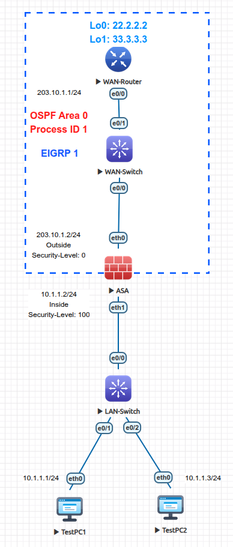

<div align="center">

# 🛡️ Cisco ASA: Initialization, Security Zones & Edge Routing

[-00599C?style=for-the-badge&logo=cisco&logoColor=white)](https://cisco.com)
[](https://eve-ng.net)
[_|_Outside_(0)-brightgreen?style=for-the-badge)]()
[]()
[]()

<p align="center">
  <b>Hands-on deployment of a Cisco ASA 5520 firewall in EVE-NG: interface security zones, stateful ICMP traversal dynamics, access list filtering, and OSPF vs. EIGRP routing table arbitration.</b>
</p>

</div>

---

## 🎯 What Was Performed

1. **Firewall Initialization:** Provisioned a Cisco ASA 5520 (v9.1) bridging an untrusted perimeter (`Outside`, Level 0) and an internal corporate LAN (`Inside`, Level 100) via EVE-NG.
2. **Interface Provisioning:** Enforced the 4 mandatory ASA interface pillars (`nameif`, `security-level`, `ip address`, and `no shutdown`).
3. **Transit Traffic Troubleshooting:** Diagnosed why inside-to-outside ICMP requests succeed at the remote router but drop upon return at the ASA Outside interface; resolved traversal using an inbound extended access-list.
4. **Edge Routing Configuration:** Configured static routing, default gateway forwarding (`route Outside 0.0.0.0 0.0.0.0 <gw>`), and dual dynamic routing protocols (OSPF Area 0 and EIGRP AS 1).
5. **Route Arbitration Verification:** Tested dynamic route convergence and verified that EIGRP Administrative Distance (AD 90) supersedes OSPF (AD 110) in the ASA routing table.

---

## 💡 Key Lessons & Engineering Takeaways

* **The 4 Pillars Rule:** Unlike Cisco IOS routers, an ASA interface will not forward any traffic until all four parameters are defined: `nameif`, `security-level` (0-100), `ip address`, and `no shutdown`. Configuring `nameif inside` automatically assigns security level 100; any other name defaults to 0.
* **The ICMP Inspection Trap:** The ASA tracks TCP and UDP statefully by default, but **does not inspect ICMP statefully** out of the box. Outbound pings (High-to-Low) pass, but return echo replies (Low-to-High) are dropped at the Outside interface as unsolicited untrusted traffic unless permitted by an inbound ACL or Modular Policy Framework (MPF) inspection.
* **CLI Subnet Mask Enforcement:** The ASA routing parser rejects IOS wildcard masks (`0.0.0.255`). Both OSPF and EIGRP `network` commands on the ASA strictly require standard dotted-decimal subnet masks (`255.255.255.0`).
* **Routing Table (RIB) Precedence:** When both OSPF and EIGRP advertise identical remote branch prefixes (`22.2.2.0/24`, `33.3.3.0/24`), the ASA installs EIGRP routes (`D`, AD 90) over OSPF routes (`O`, AD 110) based on standard administrative distance arbitration.
* **CLI Syntax Distinctions:** The ASA omits the `ip` keyword in multiple administrative commands: use `show route` (not `show ip route`), `show interface ip brief` (not `show ip int brief`), and `route <nameif> ...` (not `ip route ...`).

---

## 🗺️ Network Topology

<div align="center">
  
</div>

---

## 📊 Addressing & Security Zone Schema

| Device | Interface | Zone (`nameif`) | Security Level | IP Address | Subnet Mask | Function / Zone Role |
| :--- | :--- | :--- | :---: | :--- | :--- | :--- |
| **ASA** | `Ethernet0` | `Outside` | `0` | `203.10.1.2` | `255.255.255.0` | Untrusted WAN Edge Uplink |
| **ASA** | `Ethernet1` | `Inside` | `100` | `10.1.1.2` | `255.255.255.0` | Trusted Internal Corporate LAN |
| **WAN-Router** | `Ethernet0/0` | N/A | N/A | `203.10.1.1` | `255.255.255.0` | Upstream Next-Hop Transit Gateway |
| **WAN-Router** | `Loopback0` | N/A | N/A | `22.2.2.2` | `255.255.255.0` | Simulated Remote Branch Subnet 1 |
| **WAN-Router** | `Loopback1` | N/A | N/A | `33.3.3.3` | `255.255.255.0` | Simulated Remote Branch Subnet 2 |
| **TestPC1** | `eth0` | N/A | N/A | `10.1.1.1` | `255.255.255.0` | Internal Workstation 1 (GW: 10.1.1.2) |
| **TestPC2** | `eth0` | N/A | N/A | `10.1.1.3` | `255.255.255.0` | Internal Workstation 2 (GW: 10.1.1.2) |

---

## 🛠️ Configuration Highlights

### Cisco ASA 5520
```ios
hostname ASA
!
interface Ethernet0
 description WAN_Uplink_to_WAN-Switch
 nameif Outside
 security-level 0
 ip address 203.10.1.2 255.255.255.0
 no shutdown
!
interface Ethernet1
 description LAN_Downlink_to_LAN-Switch
 nameif Inside
 security-level 100
 ip address 10.1.1.2 255.255.255.0
 no shutdown
!
! Permit return transit traffic entering Outside interface (Level 0 -> 100)
access-list 101 extended permit ip any any
access-group 101 in interface Outside
!
! Dynamic Routing: Subnet masks required on ASA CLI
router ospf 1
 network 203.10.1.0 255.255.255.0 area 0
!
router eigrp 1
 network 203.10.1.0 255.255.255.0
```

### Cisco IOS WAN Router
```ios
hostname WAN-Router
!
interface Ethernet0/0
 ip address 203.10.1.1 255.255.255.0
 no shutdown
!
interface Loopback0
 ip address 22.2.2.2 255.255.255.0
!
interface Loopback1
 ip address 33.3.3.3 255.255.255.0
!
router ospf 1
 network 203.10.1.0 0.0.0.255 area 0
 network 22.2.2.0 0.0.0.255 area 0
 network 33.3.3.0 0.0.0.255 area 0
!
router eigrp 1
 network 203.10.1.0 0.0.0.255
 network 22.2.2.0 0.0.0.255
 network 33.3.3.0 0.0.0.255
 no auto-summary
```

---

## 🔍 Verification & Evidence

### 1. Logical Security Zones & Interface State
```text
ASA# show nameif
Interface                  Name                     Security
Ethernet0                  Outside                    0
Ethernet1                  Inside                   100

ASA# show interface ip brief
Interface                  IP-Address      OK? Method Status                Protocol
Ethernet0                  203.10.1.2      YES manual up                    up
Ethernet1                  10.1.1.2        YES manual up                    up
```

### 2. Inbound ACL Hit Count (Transit Traffic Permitted)
```text
ASA# show access-list
access-list 101; 1 elements; name hash: 0xe77d50b5
access-list 101 line 1 extended permit ip any any (hitcnt=5) 0x20676dfa
```

### 3. Route Arbitration: EIGRP (AD 90) Supersedes OSPF (AD 110)
```text
ASA# show route
Codes: C - connected, S - static, D - EIGRP, O - OSPF
...
D    22.2.2.0 255.255.255.0 [90/156160] via 203.10.1.1, Outside
D    33.3.3.0 255.255.255.0 [90/156160] via 203.10.1.1, Outside
C    203.10.1.0 255.255.255.0 is directly connected, Outside
C    10.1.1.0 255.255.255.0 is directly connected, Inside
```

---

## 📦 Artifacts Checklist

* `cisco-asa-basic-initialization-routing.unl` - EVE-NG lab topology XML file.
* `topology.png` - Visual architecture diagram.
* `asa-config.ios` - Full Cisco ASA 5520 configuration.
* `wan-router-config.ios` - Upstream WAN router configuration.
* `wan-switch-config.ios` - Layer 2 WAN switch configuration.
* `lan-switch-config.ios` - Layer 2 LAN switch configuration.
