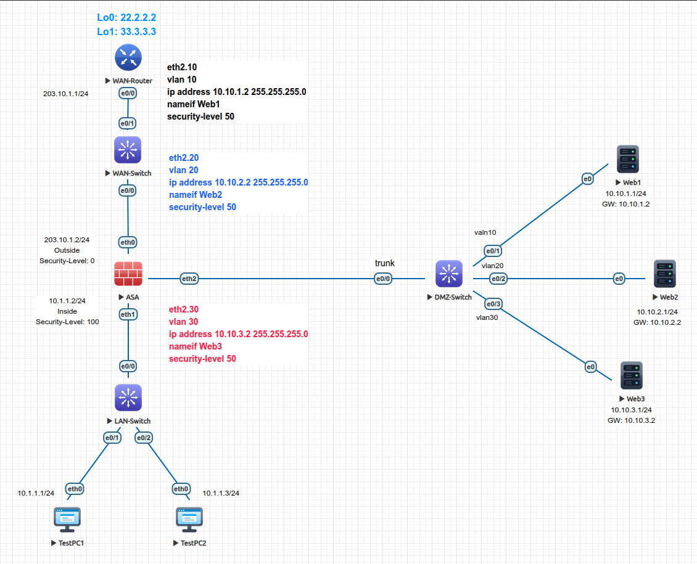

<div align="center">

# 🛡️ Cisco ASA: Extended ACLs, Object Groups, DMZ & 802.1Q Sub-Interfaces

[-00599C?style=for-the-badge&logo=cisco&logoColor=white)](https://cisco.com)
[](https://eve-ng.net)
[_|_DMZ_(50)_|_Outside_(0)-brightgreen?style=for-the-badge)]()
[]()
[]()

<p align="center">
  <b>Enterprise multi-tier perimeter security deployment in EVE-NG: 802.1Q sub-interface segmentation, DMZ semi-trusted isolation (Level 50), object-group combinatorial rule compression (32:1), stateful 5-tuple connection tracking, and Tiny Core Linux persistence.</b>
</p>

</div>

---

## 🎯 What Was Performed

1. **DMZ Architecture & 802.1Q VLAN Trunking:** Partitioned physical interface `Ethernet2` on a Cisco ASA 5520 into three logical sub-interfaces (`Ethernet2.10`, `Ethernet2.20`, `Ethernet2.30`), terminating distinct VLAN tags on an upstream Cisco IOL Layer 2 DMZ switch.
2. **Semi-Trusted Security Zoning:** Established a 3-tier trust hierarchy: `Inside` (Level 100), `DMZ` web tiers (Level 50), and `Outside` (Level 0) to enforce perimeter blast radius containment.
3. **Object-Group Policy Consolidation:** Replaced 32 lines of manual access-list syntax with a single consolidated rule using network and service object-group containers.
4. **Intra-Zone Traffic Control:** Configured `same-security-traffic permit inter-interface` to control and allow communication across isolated sub-interfaces sharing Security Level 50.
5. **Linux Web Services & Persistence:** Deployed 3x Tiny Core Linux server appliances, configured static network parameters, authored custom HTML headers, and committed filesystems to virtual flash using `filetool.sh -b`.

---

## 💡 Key Lessons & Engineering Takeaways

* **Stateful 5-Tuple Connection Tracking:** Unlike stateless Cisco IOS router ACLs, an ASA access-list functions as a stateful gatekeeper. Inbound permitted traffic creates a dynamic entry in the `conn` table (Source IP, Source Port, Dest IP, Dest Port, Protocol). Return replies automatically bypass the Outside ACL and security level checks.
* **Combinatorial Compression of Object-Groups:** Traditional ACLs scale exponentially: $\text{Total ACEs} = N_{\text{src}} \times N_{\text{dst}} \times N_{\text{ports}}$. For 4 hosts, 4 servers, and 2 ports, a manual ACL requires 32 lines ($4 \times 4 \times 2 = 32$). Grouping them into `object-group network` and `object-group service` compresses the operational configuration into **1 readable line**, while the ASA kernel automatically compiles and tracks the 32 underlying ACEs.
* **ASA Sub-Interface Parent Port Rules:** The parent physical interface (`Ethernet2`) must operate in a purely Layer 2 carrier mode without Layer 3 attributes (`no nameif`, `no security-level`, `no ip address`, `no shutdown`). All IP addresses, zone names, and security levels must reside exclusively on child sub-interfaces tagged via the `vlan <id>` command.
* **Inter-DMZ Same-Security Isolation:** The ASA drops traffic attempting to transit between interfaces possessing the identical numeric security level (e.g. `Web1` at Level 50 to `Web2` at Level 50). Enabling `same-security-traffic permit inter-interface` is mandatory for controlled inter-tier data exchange.
* **RAM-Disk Operating System Persistence:** In lightweight virtualized appliances (Tiny Core Linux), network modifications and web assets reside strictly in volatile RAM. Executing `filetool.sh -b` prior to rebooting is required to archive configuration state back to virtual disk.

---

## 🗺️ Network Topology

<div align="center">
  
</div>

---

## 📊 Addressing & Security Zone Schema

| Device | Interface | 802.1Q VLAN | Zone (`nameif`) | Security Level | IP Address | Subnet Mask | Function / Zone Role |
| :--- | :--- | :---: | :--- | :---: | :--- | :--- | :--- |
| **ASA** | `Ethernet0` | Native | `Outside` | `0` | `203.10.1.2` | `255.255.255.0` | Untrusted WAN Perimeter Uplink |
| **ASA** | `Ethernet1` | Native | `Inside` | `100` | `10.1.1.2` | `255.255.255.0` | Trusted Internal Corporate LAN |
| **ASA** | `Ethernet2` | Dot1Q Trunk | *(Parent)* | N/A | *(No IP)* | N/A | Physical Trunk Carrier to DMZ-Switch |
| **ASA** | `Ethernet2.10`| `10` | `Web1` | `50` | `10.10.1.2` | `255.255.255.0` | DMZ Web Tier 1 Gateway |
| **ASA** | `Ethernet2.20`| `20` | `Web2` | `50` | `10.10.2.2` | `255.255.255.0` | DMZ Web Tier 2 Gateway |
| **ASA** | `Ethernet2.30`| `30` | `Web3` | `50` | `10.10.3.2` | `255.255.255.0` | DMZ Web Tier 3 Gateway |
| **DMZ-Switch**| `Eth0/0` | Trunk (10,20,30) | N/A | N/A | Unnumbered | Layer 2 | Trunk Uplink to ASA Ethernet2 |
| **DMZ-Switch**| `Eth0/1 - Eth0/3` | Access (10,20,30) | N/A | N/A | Unnumbered | Layer 2 | Access Downlinks to Web Servers |
| **Web1** | `eth0` | Access 10 | N/A | N/A | `10.10.1.1` | `255.255.255.0` | DMZ Linux Web Server 1 (GW: 10.10.1.2) |
| **Web2** | `eth0` | Access 20 | N/A | N/A | `10.10.2.1` | `255.255.255.0` | DMZ Linux Web Server 2 (GW: 10.10.2.2) |
| **Web3** | `eth0` | Access 30 | N/A | N/A | `10.10.3.1` | `255.255.255.0` | DMZ Linux Web Server 3 (GW: 10.10.3.2) |

---

## 🛠️ Configuration Highlights

### Cisco ASA 5520 (Sub-Interfaces & Object Groups)
```ios
! Parent Physical Interface (Trunk carrier - No IP or Nameif allowed)
interface Ethernet2
 no shutdown
 no ip address
!
! Logical 802.1Q Sub-Interfaces
interface Ethernet2.10
 vlan 10
 nameif Web1
 security-level 50
 ip address 10.10.1.2 255.255.255.0
 no shutdown
!
interface Ethernet2.20
 vlan 20
 nameif Web2
 security-level 50
 ip address 10.10.2.2 255.255.255.0
 no shutdown
!
interface Ethernet2.30
 vlan 30
 nameif Web3
 security-level 50
 ip address 10.10.3.2 255.255.255.0
 no shutdown
!
! Intra-DMZ Communication Permit (Level 50 <-> Level 50)
same-security-traffic permit inter-interface
!
! Object-Group Definitions
object-group network HOSTS
 network-object host 192.168.1.1
 network-object host 192.168.1.2
 network-object host 192.168.1.3
 network-object host 192.168.1.4
!
object-group network SERVERS
 network-object host 10.1.1.1
 network-object host 10.1.1.2
 network-object host 10.1.1.3
 network-object host 10.1.1.4
!
object-group service PORTS tcp
 port-object eq 23
 port-object eq 80
!
! Single Consolidated Rule (Expands to 32 elements internally)
access-list INSIDE_IN extended permit tcp object-group HOSTS object-group SERVERS object-group PORTS
access-group INSIDE_IN in interface Inside
```

### DMZ Switch (Cisco IOS Layer 2)
```ios
hostname DMZ-Switch
!
vlan 10,20,30
!
interface Ethernet0/0
 description Trunk_Uplink_to_ASA_Ethernet2
 switchport trunk encapsulation dot1q
 switchport mode trunk
 switchport trunk allowed vlan 10,20,30
 no shutdown
!
interface Ethernet0/1
 switchport mode access
 switchport access vlan 10
!
interface Ethernet0/2
 switchport mode access
 switchport access vlan 20
!
interface Ethernet0/3
 switchport mode access
 switchport access vlan 30
```

---

## 🔍 Verification & Evidence

### 1. Object-Group Rule Expansion (32 Discrete ACEs Generated)
```text
ASA# show access-list INSIDE_IN
access-list INSIDE_IN; 33 elements; name hash: 0x4f4313c6
access-list INSIDE_IN line 1 extended permit tcp object-group HOSTS object-group SERVERS object-group PORTS (hitcnt=0) 0xd94b5247
  access-list INSIDE_IN line 1 extended permit tcp host 192.168.1.1 host 10.1.1.1 eq telnet (hitcnt=0) 0x5e6af8e1
  access-list INSIDE_IN line 1 extended permit tcp host 192.168.1.1 host 10.1.1.1 eq www (hitcnt=0) 0x6e21b7c4
  access-list INSIDE_IN line 1 extended permit tcp host 192.168.1.1 host 10.1.1.2 eq telnet (hitcnt=0) 0xd77a11a0
  access-list INSIDE_IN line 1 extended permit tcp host 192.168.1.1 host 10.1.1.2 eq www (hitcnt=0) 0xbb046522
  ... [Total 32 expanded combinations tracked individually with hit counts]
```

### 2. Sub-Interface Layer 3 Status
```text
ASA# show interface ip brief
Interface                  IP-Address      OK? Method Status                Protocol
Ethernet0                  203.10.1.2      YES manual up                    up
Ethernet1                  10.1.1.2        YES manual up                    up
Ethernet2                  unassigned      YES unset  up                    up
Ethernet2.10               10.10.1.2       YES manual up                    up
Ethernet2.20               10.10.2.2       YES manual up                    up
Ethernet2.30               10.10.3.2       YES manual up                    up
```

### 3. Security Zone Allocation
```text
ASA# show nameif
Interface                  Name                     Security
Ethernet0                  Outside                    0
Ethernet1                  Inside                   100
Ethernet2.10               Web1                      50
Ethernet2.20               Web2                      50
Ethernet2.30               Web3                      50
```

---

## 📦 Included Artifacts Checklist

* `cisco-asa-extended-acls-object-groups.unl` - Complete EVE-NG topology XML ready for import.
* `topology.png` - Architecture and VLAN sub-interface diagram.
* `asa-config.ios` - Cisco ASA 5520 configuration with 802.1Q sub-interfaces and object-groups.
* `dmz-switch-config.ios` - Cisco IOS DMZ switch 802.1Q trunk and access port configuration.
* `wan-router-config.ios` - Upstream WAN router configuration.
* `wan-switch-config.ios` - Layer 2 WAN bridging configuration.
* `lan-switch-config.ios` - Layer 2 LAN access configuration.
