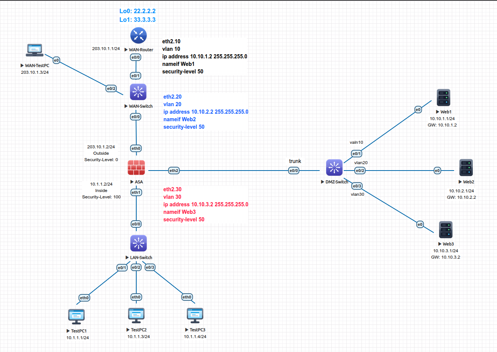
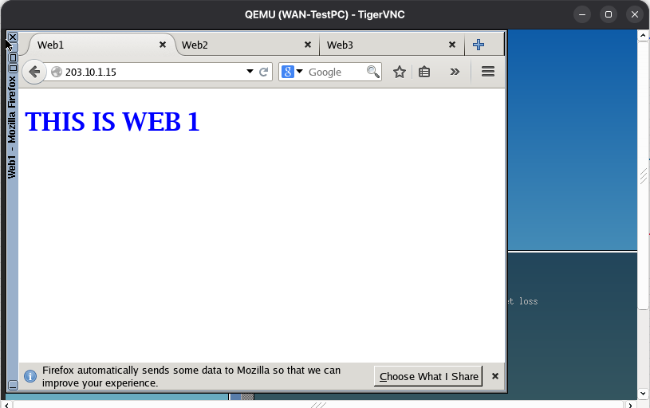

<div align="center">

# 🛡️ Cisco ASA: NAT, PAT (Overload), DMZ Web Server Publishing & Post-NAT ACLs

[-00599C?style=for-the-badge&logo=cisco&logoColor=white)](https://cisco.com)
[](https://eve-ng.net)
[_|_DMZ_(50)_|_Outside_(0)-brightgreen?style=for-the-badge)]()
[_|_DNAT_Server_Publishing_|_Post--NAT_ACLs-blueviolet?style=for-the-badge)]()
[]()

<p align="center">
  <b>Comprehensive perimeter translation and server publishing in EVE-NG: Static NAT (1:1), Dynamic NAT pool exhaustion, Port Address Translation (PAT / Overload), DMZ multi-tier Destination NAT, and ASA 9.x Un-NAT Real IP access list enforcement.</b>
</p>

</div>

---

## 🎯 What Was Performed

1. **Static NAT (1:1 Mappings):** Configured dedicated one-to-one address translations for internal endpoints (`10.1.1.1` to `203.10.1.50`, `10.1.1.3` to `203.10.1.60`) and verified real-time source address rewriting via WAN router packet debugging.
2. **Dynamic NAT & Pool Exhaustion Analysis:** Built a 2-IP public allocation pool (`203.10.1.10 - .11`), bound the inside subnet, and triggered pool starvation drops on a 3rd host (`TestPC3`) when pool capacity was exceeded.
3. **Port Address Translation (PAT / NAT Overload):** Configured `nat (Inside,Outside) dynamic interface` to multiplex the entire inside corporate subnet across the firewall's single public egress IP (`203.10.1.2`) using Layer 4 port tracking.
4. **Destination NAT (DMZ Web Server Publishing):** Published 3 internal Linux web servers hosted across 802.1Q sub-interfaces (`Ethernet2.10`, `Ethernet2.20`, `Ethernet2.30`) to dedicated public VIPs (`203.10.1.15`, `.20`, `.25`).
5. **Post-NAT Inbound Access Control (ASA 9.x Real IP Rule):** Configured outside inbound ACLs matching the servers' real private IP addresses (`10.10.1.1`, `.2.1`, `.3.1`), adhering to the ASA 9.x packet traversal order of operations.
6. **End-to-End External Client Verification:** Verified HTTP connectivity from an external WAN Linux client (`203.10.1.3`) in Firefox, validating address translation, routing, and access list hit count increments.

---

## 💡 Key Lessons & Engineering Takeaways

* **ASA 9.x Un-NAT Order of Operations (The Real IP Rule):** Starting with ASA version 8.4 and continued in 9.x, the firewall performs Un-NAT (destination address translation) before evaluating interface access lists. Therefore, inbound ACLs applied to the Outside interface must match the **real private IP address** of the internal server, not the public mapped VIP. Writing rules for the public IP results in silent traffic drops.
* **PAT (NAT Overload) Efficiency:** Dynamic NAT allocates public IPs on a temporary 1:1 basis, quickly exhausting public IP blocks. PAT multiplexes unique Layer 4 source ports (TCP/UDP/ICMP identifiers) over a single egress IP, allowing thousands of internal hosts to share one routable address without exhaustion.
* **Dynamic Pool Starvation:** When dynamic pool capacity is exhausted (e.g. 2 usable IPs with 3 concurrent hosts), the ASA drops translation requests for subsequent hosts until active sessions clear from the `xlate` table (`clear xlate`).
* **Source NAT (SNAT) vs. Destination NAT (DNAT):** Source NAT (outbound egress) modifies packet source headers to conceal internal RFC 1918 subnets. Destination NAT (server publishing / VIP mapping) modifies packet destination headers so untrusted external clients can reach internal perimeter services without direct routability.
* **Stale Translation Table Locks:** Modifying NAT policies does not immediately affect active connections. Issuing `clear xlate` is required to flush cached bindings and enforce new translation logic.

---

## 🗺️ Network Topology

<div align="center">
  
</div>

---

## 📊 Addressing & NAT Mapping Schema

| Node / Role | Interface | VLAN | Security Level | Private IP (Real) | Public Mapped IP (VIP) | NAT Mode | Gateway |
| :--- | :--- | :---: | :---: | :--- | :--- | :--- | :--- |
| **ASA Outside** | `Ethernet0` | Native | `0` | `203.10.1.2/24` | N/A | Interface Carrier | N/A |
| **ASA Inside** | `Ethernet1` | Native | `100` | `10.1.1.2/24` | `203.10.1.2` | PAT (Overload) | N/A |
| **ASA Web1** | `Ethernet2.10` | `10` | `50` | `10.10.1.2/24` | `203.10.1.15` | Destination NAT | N/A |
| **ASA Web2** | `Ethernet2.20` | `20` | `50` | `10.10.2.2/24` | `203.10.1.20` | Destination NAT | N/A |
| **ASA Web3** | `Ethernet2.30` | `30` | `50` | `10.10.3.2/24` | `203.10.1.25` | Destination NAT | N/A |
| **WAN-Router** | `Ethernet0/0` | Native | N/A | `203.10.1.1/24` | N/A | Default Gateway | N/A |
| **WAN-TestPC** | `eth0` | Native | N/A | `203.10.1.3/24` | N/A | External Client | `203.10.1.2` |
| **Web1 (Linux)** | `eth0` | `10` | N/A | `10.10.1.1/24` | `203.10.1.15` | Published Web Tier 1 | `10.10.1.2` |
| **Web2 (Linux)** | `eth0` | `20` | N/A | `10.10.2.1/24` | `203.10.1.20` | Published Web Tier 2 | `10.10.2.2` |
| **Web3 (Linux)** | `eth0` | `30` | N/A | `10.10.3.1/24` | `203.10.1.25` | Published Web Tier 3 | `10.10.3.2` |
| **TestPC1** | `eth0` | Native | N/A | `10.1.1.1/24` | `203.10.1.2` (PAT) | Inside Workstation | `10.1.1.2` |
| **TestPC2** | `eth0` | Native | N/A | `10.1.1.3/24` | `203.10.1.2` (PAT) | Inside Workstation | `10.1.1.2` |
| **TestPC3** | `eth0` | Native | N/A | `10.1.1.4/24` | `203.10.1.2` (PAT) | Exhaustion Test Node | `10.1.1.2` |

---

## 🛠️ Configuration Highlights

### 1. Cisco ASA 5520 (PAT & DMZ Server Publishing)
```ios
! 1. Port Address Translation (PAT / NAT Overload) for Inside LAN
object network myInsideNetwork
 subnet 10.1.1.0 255.255.255.0
 nat (Inside,Outside) dynamic interface
!
! 2. Destination NAT (DMZ Web Server Publishing to Public VIPs)
object network Web1
 host 10.10.1.1
 nat (Web1,Outside) static 203.10.1.15
!
object network Web2
 host 10.10.2.1
 nat (Web2,Outside) static 203.10.1.20
!
object network Web3
 host 10.10.3.1
 nat (Web3,Outside) static 203.10.1.25
!
! 3. Target Web Server Object Group
object-group network WebServers
 network-object host 10.10.1.1
 network-object host 10.10.2.1
 network-object host 10.10.3.1
!
! 4. Post-NAT Access Control List (Matching REAL Private IPs)
access-list WebServers extended permit tcp any object-group WebServers eq www
access-group WebServers in interface Outside
```

### 2. Cisco ASA 5520 (Static NAT & Dynamic Pool Workbook Reference)
```ios
! Stage A: Static NAT (1:1) Workbook Reference
object network StaticPC1
 host 10.1.1.1
 nat (Inside,Outside) static 203.10.1.50
exit
object network StaticPC2
 host 10.1.1.3
 nat (Inside,Outside) static 203.10.1.60
exit

! Stage B: Dynamic NAT Pool & Exhaustion Workbook Reference
object network myNATPool
 range 203.10.1.10 203.10.1.11
exit
object network myINSIDENET
 subnet 10.1.1.0 255.255.255.0
 nat (Inside,Outside) dynamic myNATPool
exit
```

---

## 🔬 Verification & Operational Telemetry

### 1. Live Translation Table (`show xlate` on ASA)
```text
ASA# show xlate
3 in use, 3 most used
Flags: D - DNS, e - extended, I - identity, i - dynamic, r - portmap,
       s - static, T - twice, N - net-to-net
NAT from Web1:10.10.1.1 to Outside:203.10.1.15
    flags s idle 0:05:33 timeout 0:00:00
NAT from Web2:10.10.2.1 to Outside:203.10.1.20
    flags s idle 0:03:42 timeout 0:00:00
NAT from Web3:10.10.3.1 to Outside:203.10.1.25
    flags s idle 0:03:37 timeout 0:00:00
```

### 2. NAT Policy Statistics & Hit Counters (`show nat` on ASA)
```text
ASA# show nat
Auto NAT Policies (Section 2)
1 (Web1) to (Outside) source static Web1 203.10.1.15  
    translate_hits = 0, untranslate_hits = 37
2 (Web2) to (Outside) source static Web2 203.10.1.20  
    translate_hits = 0, untranslate_hits = 87
3 (Web3) to (Outside) source static Web3 203.10.1.25  
    translate_hits = 0, untranslate_hits = 58
4 (Inside) to (Outside) source dynamic myInsideNetwork interface  
    translate_hits = 6, untranslate_hits = 4
```
*Note: External HTTP requests hitting public VIPs increment `untranslate_hits` as packets enter through Outside, are un-NATed to private IPs, evaluated against the Real IP ACL, and return as translated responses.*

### 3. Post-NAT Access Control Hits (`show access-list WebServers` on ASA)
```text
ASA# show access-list WebServers
access-list WebServers; 3 elements; name hash: 0x806d5342
access-list WebServers line 1 extended permit tcp any object-group WebServers eq www (hitcnt=10) 0xa515c490 
  access-list WebServers line 1 extended permit tcp any host 10.10.1.1 eq www (hitcnt=5) 0x9c5d7207 
  access-list WebServers line 1 extended permit tcp any host 10.10.2.1 eq www (hitcnt=3) 0x233180f9 
  access-list WebServers line 1 extended permit tcp any host 10.10.3.1 eq www (hitcnt=2) 0x30a8c115 
```

### 4. External Client HTTP Verification (Firefox on WAN-TestPC)
Connecting from WAN-TestPC (`203.10.1.3`) to public VIP `http://203.10.1.15` successfully renders the internal DMZ web page:

<div align="center">
  
</div>

---

## 📁 Repository Structure & Artifacts

| File | Description |
| :--- | :--- |
| [`cisco-asa-nat-pat-dmz-publishing.unl`](cisco-asa-nat-pat-dmz-publishing.unl) | Complete EVE-NG lab topology definition file |
| [`asa-config.ios`](asa-config.ios) | Sanitized Cisco ASA 5520 configuration (PAT, DNAT, Real IP ACLs) |
| [`dmz-switch-config.ios`](dmz-switch-config.ios) | Sanitized Cisco IOL Layer 2 DMZ distribution switch configuration |
| [`wan-router-config.ios`](wan-router-config.ios) | Sanitized Cisco IOL Layer 3 WAN router configuration |
| [`wan-switch-config.ios`](wan-switch-config.ios) | Sanitized Cisco IOL Layer 2 WAN switch configuration |
| [`lan-switch-config.ios`](lan-switch-config.ios) | Sanitized Cisco IOL Layer 2 LAN access switch configuration |
| [`topology.png`](topology.png) | High-resolution cropped network topology diagram |
| [`proof.png`](proof.png) | End-to-end browser HTTP verification capture on WAN-TestPC |
