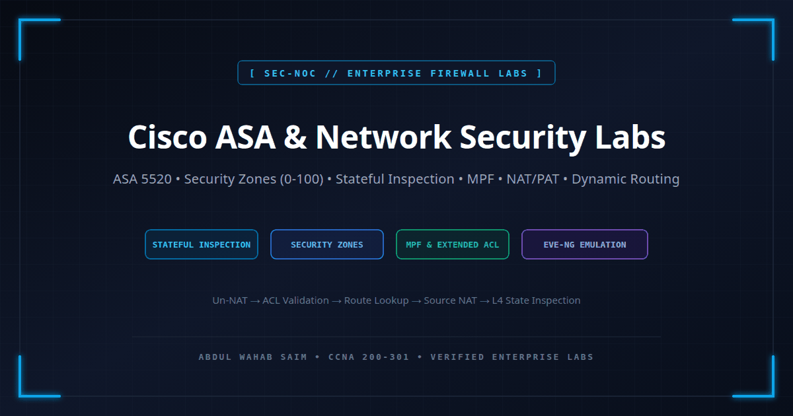
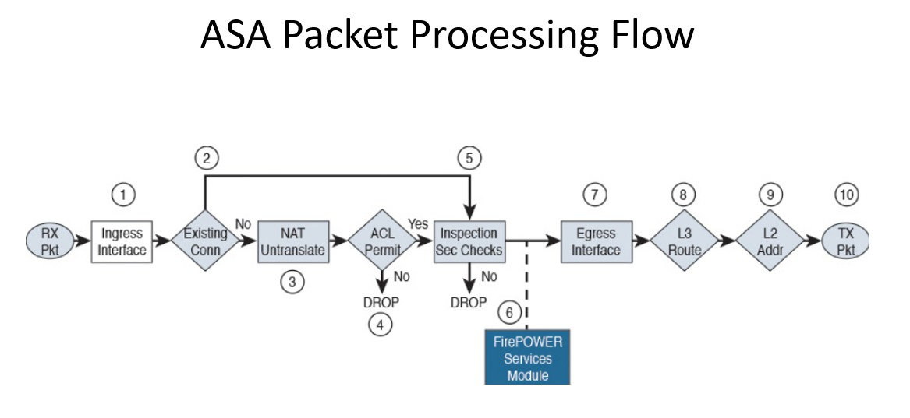

<div align="center">

# 🛡️ Cisco ASA & Enterprise Network Security Labs

[](https://cisco.com)
[](https://cisco.com)
[](https://eve-ng.net)
[](https://cp.certmetrics.com/cisco/en/public/verify/credential/CSCO15110282)
[]()

<p align="center">
  <b>A comprehensive, production-standard enterprise security engineering portfolio covering Cisco ASA 5520 Adaptive Security Appliances, Cisco Firepower Threat Defense (FTD), Stateful Packet Inspection, Security Zone Hierarchies (0-100), Modular Policy Framework (MPF), Network Address Translation (NAT/PAT), Site-to-Site IPsec VPNs, and Edge Dynamic Routing.</b>
</p>

---



</div>

---

## 📌 Executive Overview

This repository demonstrates the architecture, configuration, security policy enforcement, and verification of enterprise perimeter firewalls. Built in **EVE-NG Community** utilizing **Cisco ASA 5520 (Software Version 9.1(5))** appliances and Cisco IOS routers, each lab addresses real-world enterprise infrastructure challenges.

Unlike traditional packet-filtering routers, the Cisco ASA operates as a **stateful security boundary**. All topologies emphasize **zero-trust zone isolation**, **deterministic egress/ingress control**, **stateful connection tracking (`conn` table)**, and **reproducible CLI verification**.

---

## 🗺️ Master Lab Catalog & Security Engineering Roadmap

| Lab Directory | Architecture & Scenario | Core Security Features & Protocols | Target Devices | Verification Highlights | Status |
| :--- | :--- | :--- | :--- | :--- | :---: |
| [**`01-basic-firewall-initialization-routing`**](./01-basic-firewall-initialization-routing) | Perimeter Firewall Deployment | 4 Pillars of Init, Security Levels (0 vs 100), Inbound ACL, OSPF Area 0, EIGRP AS 1 | Cisco ASA 5520, Cisco IOL Router, 2x IOL Switches | EIGRP AD (90) over OSPF AD (110) arbitration, ICMP uninspected drop telemetry | ✅ **Verified** |
| **`02-extended-acls-object-groups-filtering`** | DMZ & Multi-Tier Service Filtering | Extended Access Lists, Object Groups (Network, Service), TCP/UDP Port Security | Cisco ASA 5520, Web/DNS DMZ Servers, Core Router | Hit counter validation, Bidirectional connection tracking | 🔄 *In Progress* |
| **`03-network-address-translation-static-dynamic-pat`** | Enterprise Edge Translation | Twice NAT, Dynamic PAT Overload, Static One-to-One Server Mapping | Cisco ASA 5520, Edge Transit Routers | `show xlate`, `show nat`, real-to-mapped address translation | 📅 *Roadmap* |
| **`04-modular-policy-framework-deep-inspection`** | Advanced Application Inspection | Modular Policy Framework (MPF), Class Maps, Policy Maps, ICMP & HTTP State Inspection | Cisco ASA 5520, Multi-tier Clients | Inspection engine metrics, Drop counters for protocol violations | 📅 *Roadmap* |
| **`05-site-to-site-ipsec-vpn-tunneling`** | Encrypted Site Interconnect | IKEv1/IKEv2 Phase 1 Policies, IPsec Phase 2 Transform Sets, Crypto Maps, Non-NAT ACLs | 2x Cisco ASA 5520, Transit WAN Cloud | `show crypto isakmp sa`, `show crypto ipsec sa`, ESP encapsulation | 📅 *Roadmap* |
| **`06-remote-access-ssl-anyconnect-vpn`** | Enterprise Teleworker Access | SSL VPN, Cisco AnyConnect Client Profiles, Split-Tunneling, Local AAA Identity | Cisco ASA 5520, Windows/Linux Endpoints | `show vpn-sessiondb anyconnect`, Assigned virtual IP address pool | 📅 *Roadmap* |
| **`07-active-standby-high-availability-failover`** | Edge Firewall Redundancy | Hardware Failover Link, Stateful Replication Link, MAC Address Spoofing, Unit Health Checks | 2x Cisco ASA 5520 (Pair) | Sub-second active-to-standby failover, Zero state table loss | 📅 *Roadmap* |
| **`08-cisco-firepower-threat-defense-ftd-fmc`** | Next-Generation Firewalling (NGFW) | Cisco FTD, Firepower Management Center (FMC), Snort IPS Rules, URL Filtering, AMP | Cisco FTD, Cisco FMCv | Unified security event logging, Malware and intrusion telemetry | 📅 *Roadmap* |

---

## 🏛️ Core Architecture: ASA 9.x Packet Processing Flow

Understanding the precise internal sequence of packet processing within Cisco ASA Software (v8.4+) is essential for troubleshooting translation, filtering, and routing decisions:

<div align="center">
  
</div>

### Sequential Order of Operations
1. **Ingress Interface Arrival:** The packet arrives on the physical wire and Layer 2 sanity checks are performed.
2. **Existing Connection Lookup:** The state engine inspects the accelerated connection table (`conn` table). If a matching state exists, ACL evaluation is bypassed and the packet advances directly to state inspection.
3. **NAT Untranslate (Destination NAT):** For new connections, the firewall evaluates destination NAT rules to resolve the real IP address before access-list verification.
4. **Access Control List (ACL) Evaluation:** Inbound access lists applied to the ingress interface evaluate the packet based on real (post-untranslated) IP addresses.
5. **Protocol Inspection & Security Checks:** Modular Policy Framework (MPF) engines inspect higher-layer protocol conformance (e.g. ICMP, DNS, HTTP, SIP).
6. **Egress Interface & Route Lookup:** Route determination identifies the egress interface and next-hop gateway.
7. **Source NAT Translation:** Egress translation rules are applied to the source IP address.
8. **Layer 2 Encapsulation & Transmission:** Egress ARP resolution encapsulates the packet for physical delivery.

---

## 🧰 Master CLI Reference: Cisco IOS vs. Cisco ASA

| Operational Domain | Cisco IOS Router | Cisco ASA Adaptive Security Appliance |
| :--- | :--- | :--- |
| **Interface Naming** | Hardware label only (`GigabitEthernet0/0`) | Logical zone mapping required (`nameif Outside`) |
| **Interface Security Rating** | Flat operational state | Relative integer rating (`security-level 0 - 100`) |
| **Routing Table Inspection** | `show ip route` | `show route` |
| **Interface Addressing Table** | `show ip interface brief` | `show interface ip brief` |
| **Static Route Definition** | `ip route <prefix> <mask> <next-hop>` | `route <nameif> <prefix> <mask> <next-hop>` |
| **OSPF Network Command** | Wildcard mask (`0.0.0.255`) | Standard subnet mask (`255.255.255.0`) |
| **EIGRP Network Command** | Optional wildcard mask | Strict standard subnet mask |
| **Active Connections Table** | N/A (Stateless by default) | `show conn` |
| **NAT Translations Table** | `show ip nat translations` | `show xlate` and `show nat` |
| **Privileged Command Execution** | Requires `do` prefix inside config mode | Standard `show` commands run directly from config mode |

---

## 📂 Repository File Structure

```text
cisco-asa-firewall-labs/
├── README.md                                          <-- Master Repository Index & Roadmap
├── assets/
│   ├── cisco-asa-firewall-labs-preview.png            <-- Social Open Graph Preview (1200x630)
│   ├── preview.svg                                    <-- Source Vector Asset
│   └── asa-packet-processing-flow.png                 <-- ASA 9.x Order of Operations
└── 01-basic-firewall-initialization-routing/
    ├── README.md                                      <-- Lab 01 Comprehensive Documentation
    ├── topology.png                                   <-- EVE-NG Captured Architecture Topology
    ├── cisco-asa-basic-initialization-routing.unl     <-- EVE-NG Lab Simulation File
    ├── asa-config.ios                                 <-- Cisco ASA 5520 Running Configuration
    ├── wan-router-config.ios                          <-- Upstream Transit Router Configuration
    ├── wan-switch-config.ios                          <-- Layer 2 WAN Access Switch Configuration
    └── lan-switch-config.ios                          <-- Layer 2 LAN Access Switch Configuration
```

---

## 👨‍💻 Engineer Profile

**Abdul Wahab Saim**  
*CCNA 200-301 Certified Network & IT Security Engineer (CSCO15110282)*  
* LinkedIn: [linkedin.com/in/abdulwahabsaim](https://linkedin.com/in/abdulwahabsaim)
* GitHub: [github.com/abdulwahabsaim](https://github.com/abdulwahabsaim)
* Portfolio: [abdulwahabsaim.github.io](https://abdulwahabsaim.github.io)
